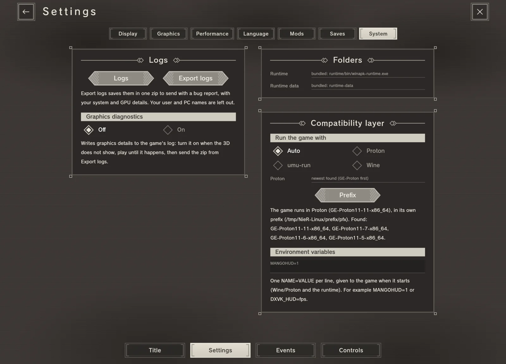
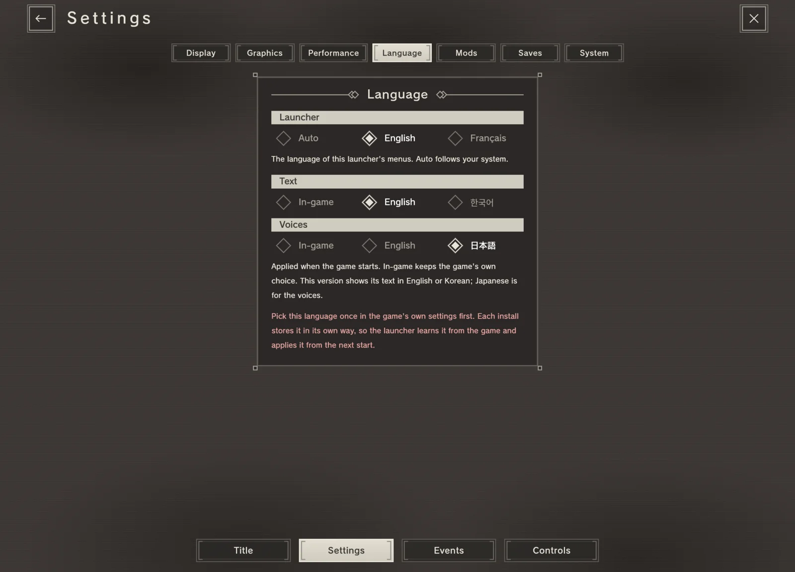

# NieR Re[in]carnation for Linux

**The NieR Re[in]carnation PC port, with a native Linux launcher.**

[Français](README.md) | **English**

## Where this comes from

The idea and nearly all of the work come from [AllenWalkerED](https://github.com/AllenWalkerED). I took
everything from their port, [nier-reincarnation-pc](https://github.com/AllenWalkerED/nier-reincarnation-pc),
which runs the game on Windows. Huge thanks to them: without that port, this repository wouldn't exist.
All I did was adapt their launcher to Linux.

## What it is

NieR Re[in]carnation shut down on April 29, 2024. AllenWalkerED's port brings it back on PC with your
own copy of the game, no phone and no internet. The Android game runs in a runtime that translates its
arm64 code to x86-64, and the fan-made [Lunar Tear](https://github.com/Walter-Sparrow/lunar-tear)
server stands in for the official ones, locally on your PC.

On Linux everything is native except the game's runtime. The launcher, the server, the setup and the
patchers are Linux programs. Only the runtime goes through Wine or Proton, in its own prefix
(`prefix/` in the game folder).

Fan project, not affiliated with SQUARE ENIX or Applibot. **The game isn't included**: you bring your
own files. The legal details are in [NOTICE.md](NOTICE.md).

## What you need

* A 64-bit Linux distribution and a GPU with Vulkan
* Python 3, 7-Zip (`7z`), and Steam's Proton, umu-launcher or Wine
* About 25 GB free, 8 GB RAM recommended

Plus the three game files:

1. the arm64 APK, version **3.7.1-152** (`com.square_enix.android_googleplay.nierspww`)
2. `resource_dump_android.7z` (the asset dump)
3. `20240404193219.bin.e` (the master data)

The asset dump and master data are on the [Lunar Tear](https://github.com/Walter-Sparrow/lunar-tear)
Discord: https://discord.gg/MZAf5aVkJG. Please don't post any of these files in issues.

## Setup

Run `./nier-launcher` from the game folder and give it the three files. The first run unpacks about
21 GB and patches the game, which takes a while. Your original files aren't touched.

Then hit **START**. The first sessions feel a bit sluggish while the game's code gets translated in the
background (about 15 minutes in total).

Got a save on your phone (Bunker)? Export it there, then Settings > Saves > **Import from phone**.

## Game languages

Text can be English or Korean, voices English or Japanese. Before you pick a language in the launcher,
pick it once in the game's own settings. The game encrypts that setting with a key unique to each
install, so the launcher can't write it blind: it reads the value while the game runs and applies it
from the next start. The launcher shows this reminder when you change languages.

## Changes from the Windows launcher

* It's a native Linux program (Rust and egui) instead of the WebView2 page, with the same menus.
* The interface comes in French too: Settings > Language > Launcher.
* It no longer checks for updates and contacts no website.
* Settings > System > Compatibility layer picks what runs the game. Auto tries umu-run, then Proton
  (GE-Proton first), then Wine.
* The same tab takes environment variables, one per line (`MANGOHUD=1`, `DXVK_HUD=fps`...), passed to
  the game when it starts.
* Vulkan is the default renderer. Direct3D 11 goes through DXVK.
* The server, setup and patchers run natively, with the system's Python 3 (in `tools/venv`, made at
  the first start) and its 7-Zip.
* The text and voice languages are learned from the game instead of being fixed values (see above).
  Fixed values only worked on the machine they were taken from.

## Something broke?

* Black or weird graphics: switch the renderer in Settings > Display.
* The game won't start: try another layer in Settings > System.
* Bug report: Settings > System > **Export logs**, then open an issue with the zip. It leaves out your
  user and PC names.

## Building

* Runtime: win.apk at commit `640f38f06c4934664767abc365a43b3c6bd7dea3` with
  `git apply winapk/winapk-nier.patch`, built per its README. It's a Windows build that Wine or Proton
  runs. You can also take the `runtime/` folder from a Windows release.
* Server: `cd server && go build ./cmd/...` (Go 1.22+).
* Launcher: `cd launcher && cargo build --release`, then `cargo test`.
* Release folder: `scripts/build_linux.sh --out <folder> --runtime <the runtime folder, or an extracted
  Windows release>` (Go and cargo).

To try the launcher without installing it: `NIER_ROOT=<game folder> launcher/target/release/nier-launcher`.

## Credits

The PC port is [AllenWalkerED](https://github.com/AllenWalkerED/nier-reincarnation-pc)'s work. The
Linux launcher port is AnnoyedDev's.

Thanks also to [Lunar Tear](https://github.com/Walter-Sparrow/lunar-tear) for bringing the game back,
[win.apk](https://github.com/israel2176/win.apk) for the runtime, and [Bunker](https://github.com/veritr1x/bunker),
whose APK patches and server changes are included under the MIT license. And to
[Lunar Base](https://github.com/NMeliksah/lunar-base), the
[Lunar Tear Comfort Mod](https://github.com/NavHobbyDev/lunar-tear-comfort-mod),
[lunar-tear-masterdata-patcher](https://github.com/NavHobbyDev/lunar-tear-masterdata-patcher), ANGLE,
Eclipse Temurin, LLVM, texture2ddecoder, UnityPy and 7-Zip.

## License

AGPL-3.0 ([LICENSE](LICENSE)). Bundled parts keep their own license: see [NOTICE.md](NOTICE.md) and
`licenses/`.
