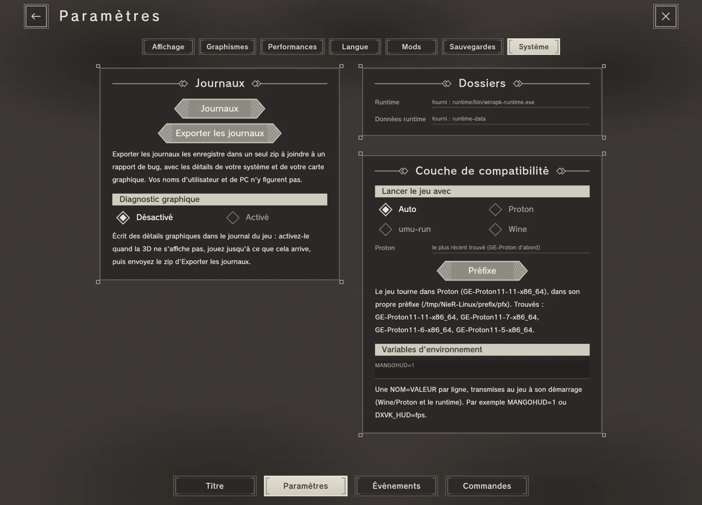
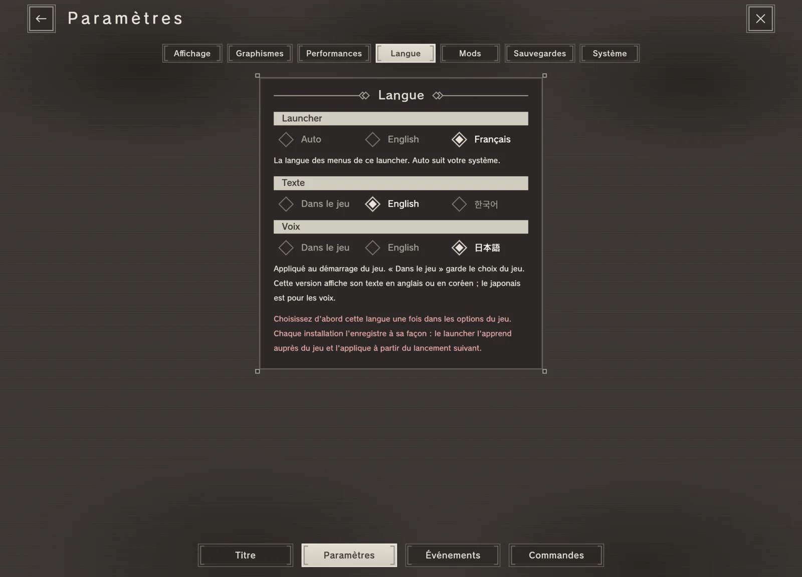

# NieR Re[in]carnation pour Linux

**Le portage PC de NieR Re[in]carnation, avec un launcher natif pour Linux.**

**Français** | [English](README.en.md)

## D'où ça vient

L'idée et presque tout le travail viennent d'[AllenWalkerED](https://github.com/AllenWalkerED). J'ai
tout repris de son portage, [nier-reincarnation-pc](https://github.com/AllenWalkerED/nier-reincarnation-pc),
qui fait tourner le jeu sur Windows. Un immense merci à AllenWalkerED : sans ce portage, ce dépôt n'existerait
pas. Je me suis contenté d'adapter son launcher à Linux.

## Ce que c'est

NieR Re[in]carnation a fermé le 29 avril 2024. Le portage d'AllenWalkerED le fait revivre sur PC avec
votre propre copie du jeu : pas de téléphone, pas d'internet. Le jeu Android tourne dans un runtime
qui traduit son code arm64 en x86-64, et le serveur fan [Lunar Tear](https://github.com/Walter-Sparrow/lunar-tear)
remplace les serveurs officiels, en local sur votre PC.

Sous Linux, tout tourne en natif sauf le runtime du jeu. Le launcher, le serveur, l'installation et
les patchs sont des programmes Linux. Seul le runtime passe par Wine ou Proton, dans son propre
préfixe (`prefix/` dans le dossier du jeu).

Projet de fans, sans lien avec SQUARE ENIX ni Applibot. **Le jeu n'est pas fourni** : vous apportez
vos propres fichiers. Les détails légaux sont dans [NOTICE.md](NOTICE.md).

## Ce qu'il faut

* Une distribution Linux 64 bits et une carte graphique compatible Vulkan
* Python 3, 7-Zip (`7z`), et Proton (Steam), umu-launcher ou Wine
* Environ 25 Go libres, 8 Go de RAM conseillés

Et les trois fichiers du jeu :

1. l'APK arm64, version **3.7.1-152** (`com.square_enix.android_googleplay.nierspww`)
2. `resource_dump_android.7z` (les assets)
3. `20240404193219.bin.e` (la master data)

Les assets et la master data se trouvent sur le Discord de [Lunar Tear](https://github.com/Walter-Sparrow/lunar-tear) :
https://discord.gg/MZAf5aVkJG. Ne postez aucun de ces fichiers dans les issues.

## Installation

Lancez `./nier-launcher` depuis le dossier du jeu et donnez-lui les trois fichiers. Le premier
lancement décompresse environ 21 Go et patche le jeu, ce qui prend un moment. Vos fichiers d'origine
ne sont pas modifiés.

Ensuite, appuyez sur **START**. Les premières sessions rament un peu, le temps que le code du jeu soit
traduit en arrière-plan (environ 15 minutes au total).

Vous avez une sauvegarde sur téléphone (Bunker) ? Exportez-la là-bas, puis Paramètres > Sauvegardes >
**Importer depuis le téléphone**.

## Les langues du jeu

Le texte peut être en anglais ou en coréen, les voix en anglais ou en japonais. Avant de choisir une
langue dans le launcher, choisissez-la une première fois dans les options du jeu. Le jeu chiffre ce
réglage avec une clé propre à chaque installation, donc le launcher ne peut pas l'écrire à l'aveugle :
il relève la valeur pendant que le jeu tourne et l'applique à partir du lancement suivant. Le launcher
affiche ce rappel quand vous changez de langue.

## Ce qui change par rapport au launcher Windows

* C'est un programme Linux natif (Rust et egui) au lieu de la page WebView2, avec les mêmes menus.
* L'interface existe en français : Paramètres > Langue > Launcher.
* Il ne cherche plus de mises à jour et ne contacte aucun site.
* Paramètres > Système > Couche de compatibilité choisit ce qui lance le jeu. Auto essaie umu-run,
  puis Proton (GE-Proton d'abord), puis Wine.
* Le même onglet accepte des variables d'environnement, une par ligne (`MANGOHUD=1`,
  `DXVK_HUD=fps`...), transmises au jeu à son démarrage.
* Vulkan est le moteur de rendu par défaut. Direct3D 11 passe par DXVK.
* Le serveur, l'installation et les patchs tournent en natif : le Python 3 du système (dans
  `tools/venv`, créé au premier lancement) et son 7-Zip.
* Les langues du texte et des voix sont apprises auprès du jeu au lieu d'être des valeurs fixes (voir
  plus haut). Les valeurs fixes ne marchaient que sur la machine où elles avaient été relevées.

## En cas de problème

* Graphismes noirs ou bizarres : changez de moteur de rendu dans Paramètres > Affichage.
* Le jeu ne démarre pas : essayez une autre couche dans Paramètres > Système.
* Pour signaler un bug : Paramètres > Système > **Exporter les journaux**, puis ouvrez une issue avec
  le zip. Vos noms d'utilisateur et de PC n'y figurent pas.

## Compiler

* Runtime : win.apk au commit `640f38f06c4934664767abc365a43b3c6bd7dea3` avec
  `git apply winapk/winapk-nier.patch`, compilé selon son README. C'est un build Windows, que Wine ou
  Proton exécute. Vous pouvez aussi reprendre le dossier `runtime/` d'une release Windows.
* Serveur : `cd server && go build ./cmd/...` (Go 1.22 ou plus).
* Launcher : `cd launcher && cargo build --release`, puis `cargo test`.
* Dossier de release : `scripts/build_linux.sh --out <dossier> --runtime <le dossier runtime, ou une
  release Windows décompressée>` (Go et cargo).

Pour essayer le launcher sans l'installer : `NIER_ROOT=<dossier du jeu> launcher/target/release/nier-launcher`.

## Crédits

Le portage PC est le travail d'[AllenWalkerED](https://github.com/AllenWalkerED/nier-reincarnation-pc).
Le portage Linux du launcher est celui d'AnnoyedDev.

Merci aussi à [Lunar Tear](https://github.com/Walter-Sparrow/lunar-tear), qui a fait revivre le jeu, à
[win.apk](https://github.com/israel2176/win.apk) pour le runtime, et à [Bunker](https://github.com/veritr1x/bunker),
dont les patchs de l'APK et les changements du serveur sont inclus sous licence MIT. Et à
[Lunar Base](https://github.com/NMeliksah/lunar-base), au
[Lunar Tear Comfort Mod](https://github.com/NavHobbyDev/lunar-tear-comfort-mod), à
[lunar-tear-masterdata-patcher](https://github.com/NavHobbyDev/lunar-tear-masterdata-patcher), ANGLE,
Eclipse Temurin, LLVM, texture2ddecoder, UnityPy et 7-Zip.

## Licence

AGPL-3.0 ([LICENSE](LICENSE)). Les composants inclus gardent leur propre licence : voir
[NOTICE.md](NOTICE.md) et `licenses/`.
